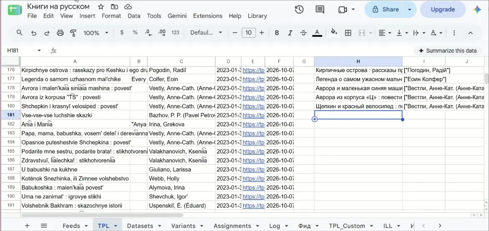
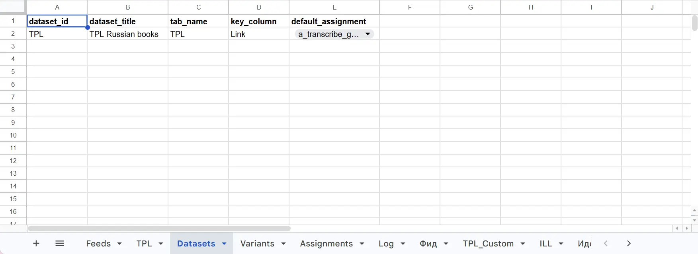

# sheets-llm-runner
A framework to process records in a spreadsheet using large language models.  

## Why it exists
This solution allows a user to process midsize datasets with large language models record by record, using a highly customizable registry of model configurations. Data and runtime are handled by Google products, while LLM calls are handled by the Perplexity Agent API. Model responses and logs are recorded as structured data.  

1. **Midsize datasets**: Smaller datasets (a few dozen rows) can be easily processed by a single interaction with an LLM. This solution is for larger datasets (several hundred rows) that may not fit in the context as easily. Processing such datasets in a chat has an increased risk of errors, and it's harder to automate, repeat, and analyze. Iterating over the dataset and calling a model through an API for every record is a more robust option.

2. **Registry of model configurations**: The API calls may use different models and prompts, allow different tools (web search, URL fetch), and request different structured outputs. Every configuration (variant) is stored in the sheet.

3. **Highly customizable**: A user can:
   - specify placeholder variables in the prompt templates so that specific attributes from the record are injected into a prompt,
   - ask for specific attributes from the model response to populate record attributes,
   - process an arbitrary set of records using any model configuration and input/output mappings,
   - set up the mappings so that an assignment can take as input data produced by another assignment.

   Each pairing of a dataset with a variant and its input/output mappings is stored in the sheet as an assignment.  

4. **Data and runtime handled by Google**: Datasets are defined as blocks of rows in Google Sheets tabs. This provides data storage and an easy user interface for data display and editing. Processes run in Google Apps Script and are launched from a custom menu in the spreadsheet. The core functionality is encapsulated in a library and can be reused from many spreadsheets.

5. **LLM calls handled by the Perplexity Agent API**: The solution expects the user to provide their Perplexity API key. This approach was chosen because:
   - the Perplexity Agent API provides access to a wide variety of models, from basic to state-of-the-art,
   - it gives access to web search and URL fetch tools that work well for web-related tasks.

6. **Model responses and logs as structured data**: The user can define a JSON schema that the model follows to produce a response. Attributes from the response can be written back to the source dataset, saved as records in a Results tab, or both. Every model call is logged as a separate record with metadata attributes. Results tab data can be used to compare outputs of different configurations. Log data can be analyzed to compare configurations in terms of success rate, tokens, cost, and latency.

## Setup

See [Setup](docs/SETUP.md).  

## Data model

See [Data model: configuration tabs and a sample dataset](docs/datamodels/config-and-sample-dataset.md).  

## Demo

The demo below shows the framework converting romanized book titles retrieved by the [tpl-tools](https://github.com/olga-terekhova/tpl-tools) project back into the original script.  

  

The demo below shows the underlying configuration tabs and the Log tab.  

  
