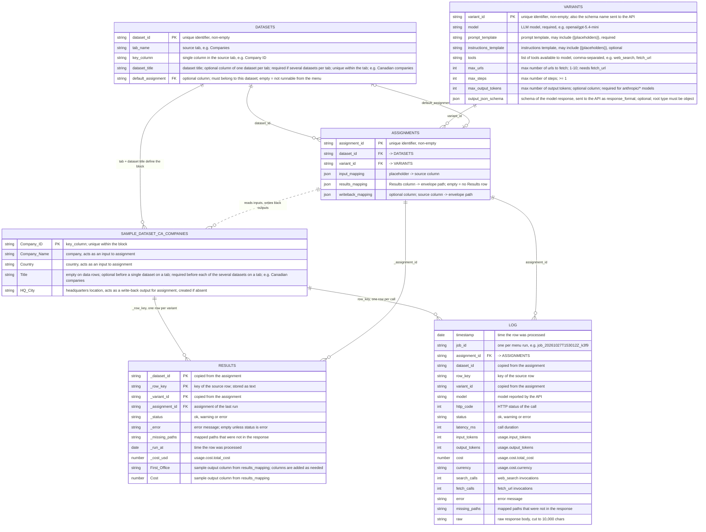

# Data model: configuration tabs and a sample dataset

The three configuration tabs (`Datasets`, `Variants`, `Assignments`), one  
sample dataset on the source tab `Companies`, and the two output tabs the  
code writes (`Results`, `Log`). The sample config rows follow the test  
fixtures in `Tests_Config.gs` (`sampleConfigValues_`, `sampleSourceValues_`).  

Mermaid attribute names cannot contain spaces, so source headers are written  
with underscores (`Company_Name` is the header `Company Name`).  

### Tables

- **DATASETS** (`Datasets` tab): one row per dataset. Says which source tab
  holds the dataset, which column is its row key, which block of rows it is  
  (by title, when a tab holds several datasets), and which assignment the  
  menu runs for its rows.  
- **VARIANTS** (`Variants` tab): one row per model configuration: model,
  prompt and instructions templates, tools and limits, and an optional JSON  
  schema for the answer. Several variants can run against the same dataset  
  for comparison.  
- **ASSIGNMENTS** (`Assignments` tab): one row per pairing of a dataset with
  a variant. Its mappings say which source columns fill the template  
  placeholders, which response values go to the `Results` tab, and which  
  are written back to the source tab.  
- **SAMPLE_DATASET_CA_COMPANIES** (`Companies` tab): an example source
  dataset, a block of Canadian companies keyed by `Company ID`. Its rows are  
  what the user selects and processes; `HQ City` is filled in by write-back.  
- **RESULTS** (`Results` tab): the latest outcome per (dataset, row key,
  variant), shared by all datasets. A re-run overwrites the row. System  
  columns start with `_`; output columns from every assignment's  
  `results_mapping` are added to the right as needed. No row is written for  
  an assignment with an empty `results_mapping`. On `error`, the  
  assignment's output columns are cleared.  
- **LOG** (`Log` tab): one appended row per API call, never overwritten:
  status, tokens, cost, timing and the raw response. A row whose call was  
  never made (e.g. a placeholder had no value) gets no Log row.  

Solid lines are references stored in cells. The dotted line is  
column-level use: an assignment reads its `input_mapping` columns from every  
row it processes and writes its `writeback_mapping` columns back by key.  

## Sample configuration rows

### Datasets

| dataset_id | tab_name | key_column | dataset_title | default_assignment |
|---|---|---|---|---|
| ca_companies | Companies | Company ID | Canadian companies | ca_hq_v1 |

The dataset is alone on its tab, so the title is optional; with an empty  
title the first block below the header row is used.  

### Variants

| variant_id | model | prompt_template | instructions_template | tools | max_urls | max_steps | max_output_tokens | output_json_schema |
|---|---|---|---|---|---|---|---|---|
| hq_v1 | openai/gpt-5.4-mini | `Find the HQ of {{company}} in {{ country }}.` | `Answer for {{company}} as JSON.` | web_search, fetch_url | 2 | 4 | 8192 | `{"type":"object","properties":{"headquarters_city":{"type":["string","null"]},"offices":{"type":"array","items":{"type":"object","properties":{"city":{"type":"string"}}}}}}` |

### Assignments

| assignment_id | dataset_id | variant_id | input_mapping | results_mapping | writeback_mapping |
|---|---|---|---|---|---|
| ca_hq_v1 | ca_companies | hq_v1 | `{"company": "Company Name", "country": "Country"}` | `{"First Office": "output_json.offices[0].city", "Cost": "usage.cost.total_cost"}` | `{"HQ City": "output_json.headquarters_city"}` |

`ca_hq_v1` writes the city back to the source tab and the first office and  
cost to `Results`.  

## Sample source tab: `Companies`

Headers are in row 1. The block is the run of keyed rows below the heading  
row; a row with an empty key ends it.  

| Sheet row | Company ID | Company Name | Country | Title | HQ City | Role |
|---|---|---|---|---|---|---|
| 1 | Company ID | Company Name | Country | Title | HQ City | header |
| 2 | | meta: used by another script | | | | skipped |
| 3 | | | | Canadian companies | | heading |
| 4 | 101 | Shopify | Canada | | | data |
| 5 | 102 | Wealthsimple | Canada | | | data |
| 6 | | | | | | ends the block |

`HQ City` is filled by `ca_hq_v1` when rows 4-5 are processed.  

## Sample output rows

After `ca_hq_v1` processes rows 4-5. Values are illustrative.

### Results

| _dataset_id | _row_key | _variant_id | _assignment_id | _status | _error | _missing_paths | _run_at | _cost_usd | First Office | Cost |
|---|---|---|---|---|---|---|---|---|---|---|
| ca_companies | 101 | hq_v1 | ca_hq_v1 | ok | | | 2026-11-05 10:12:03 | 0.0042 | Ottawa | 0.0042 |
| ca_companies | 102 | hq_v1 | ca_hq_v1 | warning | | output_json.offices[0].city | 2026-11-05 10:12:11 | 0.0039 | | 0.0039 |

Row 102 is a `warning`: the model returned no offices, so `First Office` is  
empty and the path is listed. The other values are still written.  

### Log

| timestamp | job_id | assignment_id | dataset_id | row_key | variant_id | model | http_code | status | latency_ms | input_tokens | output_tokens | cost | currency | search_calls | fetch_calls | error | missing_paths | raw |
|---|---|---|---|---|---|---|---|---|---|---|---|---|---|---|---|---|---|---|
| 2026-11-05 10:12:03 | job_20261105T101158Z_a1b2 | ca_hq_v1 | ca_companies | 101 | hq_v1 | openai/gpt-5.4-mini | 200 | ok | 7800 | 2150 | 64 | 0.0042 | USD | 1 | 1 | | | `{"id": ...}` |
| 2026-11-05 10:12:11 | job_20261105T101158Z_a1b2 | ca_hq_v1 | ca_companies | 102 | hq_v1 | openai/gpt-5.4-mini | 200 | warning | 7300 | 2080 | 41 | 0.0039 | USD | 1 | 0 | | output_json.offices[0].city | `{"id": ...}` |

Both calls share one `job_id` because they ran from one menu click.  
